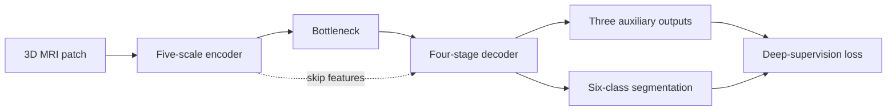
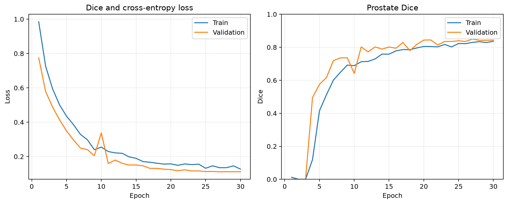
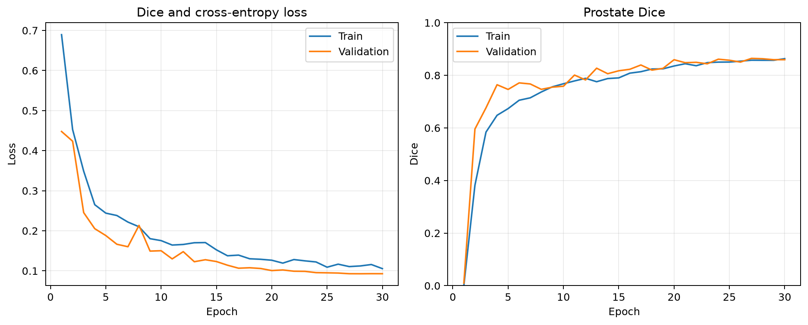
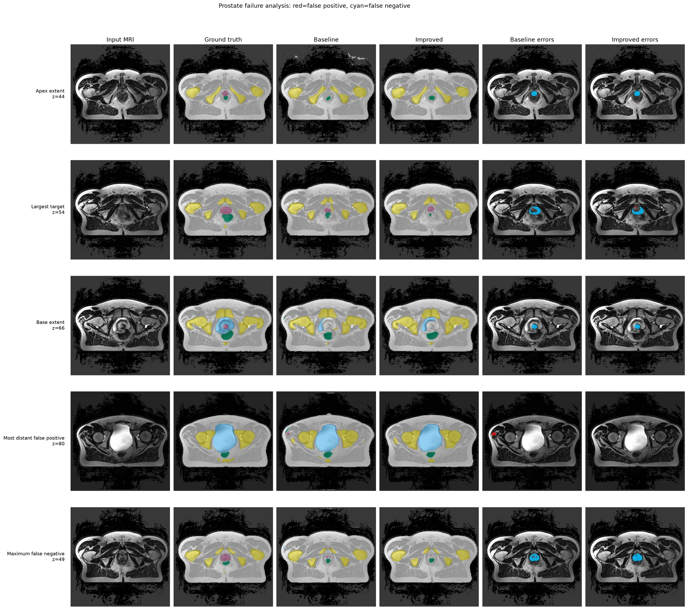
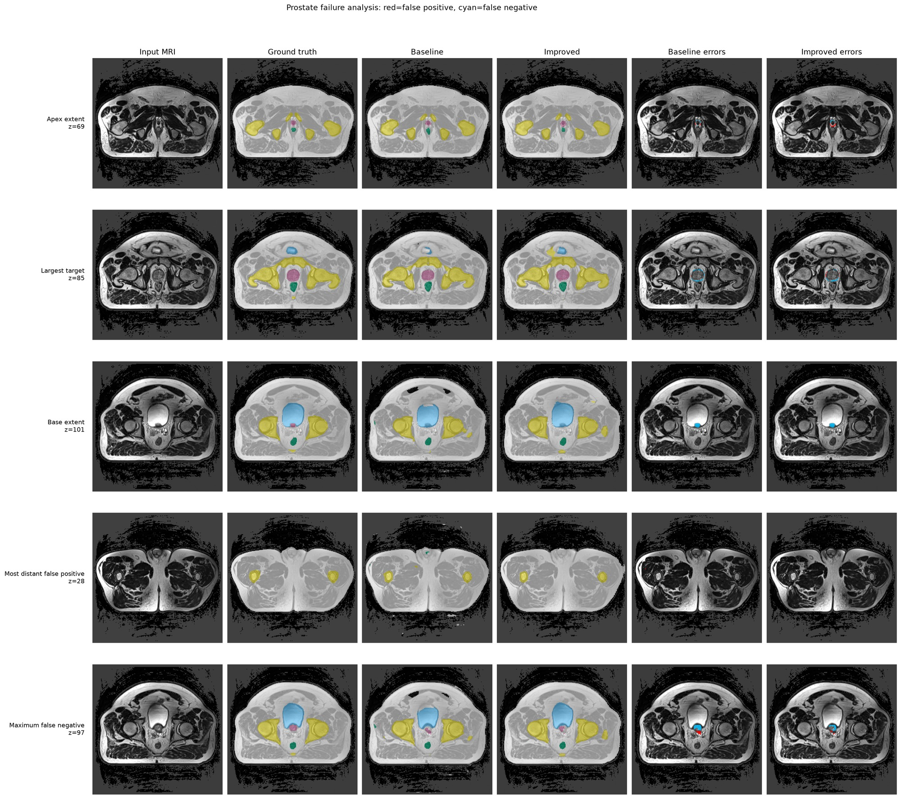
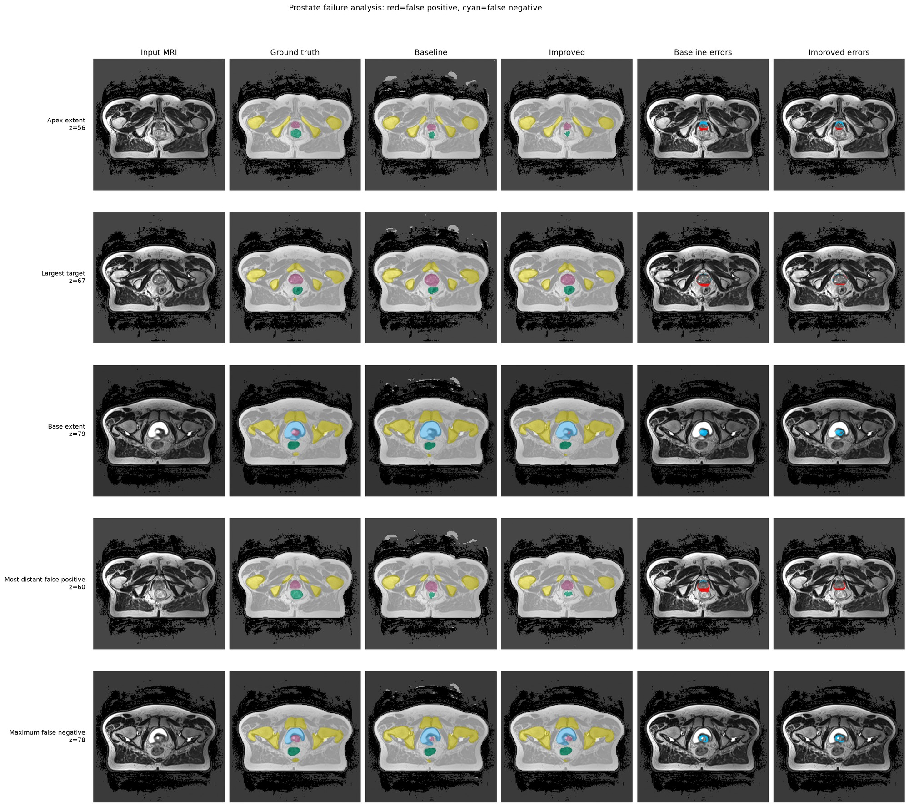
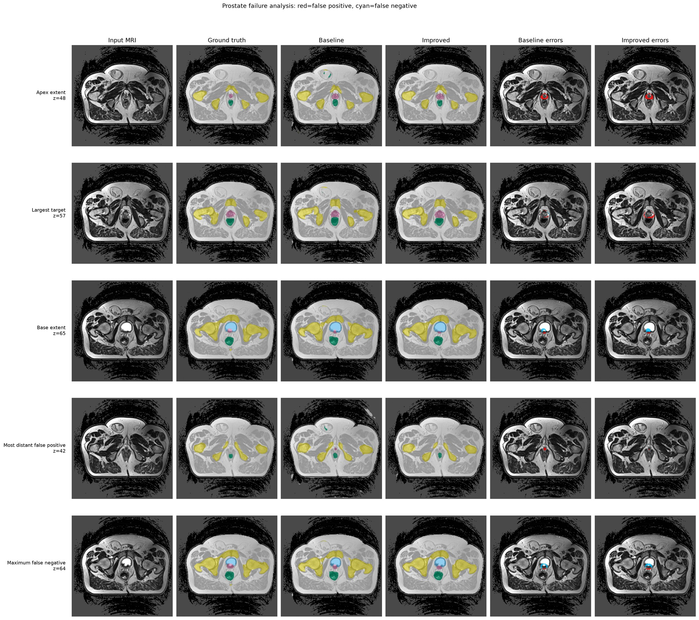
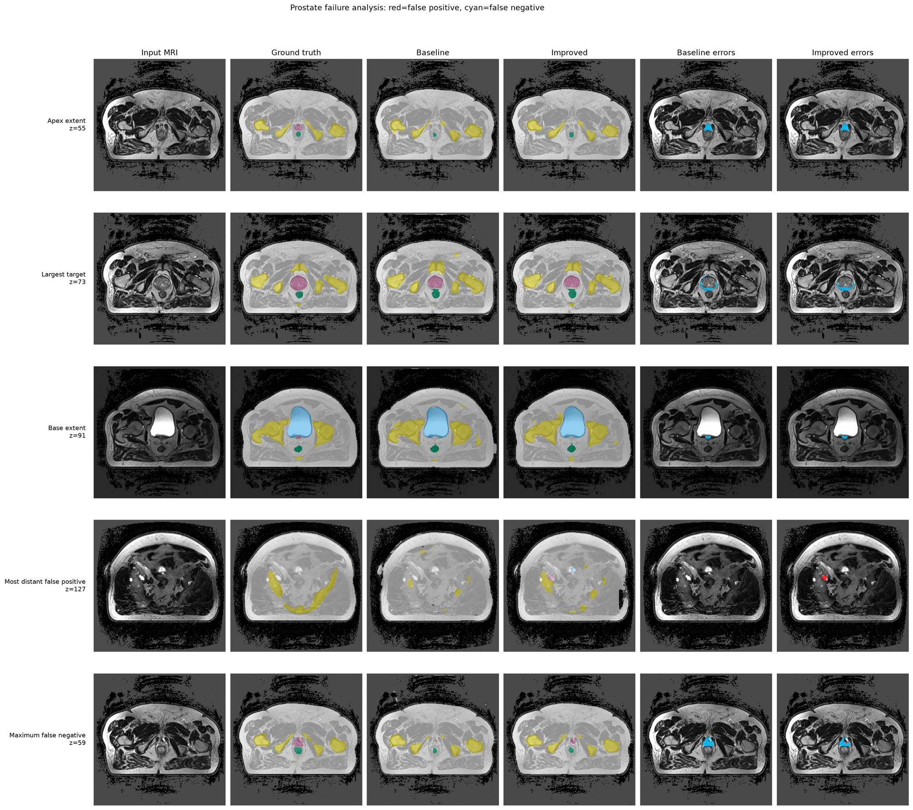

# Residual 3D Improved U-Net for HipMRI Pelvic Organ Segmentation

## Project Overview

This project implements the Hard Difficulty model from Project 2.2, Segmentation: Anatomical Contouring and Radiotherapy Planning.
It develops a 3D annotation-assistance prototype that segments the body, bone, urinary bladder, rectum, and prostate from HipMRI volumes.
The intended users are medical imaging specialists and radiation oncologists who can review and correct the predicted contours before treatment planning.
The system is not intended to make autonomous clinical decisions.

The selected model is a residual 3D Improved U-Net with deep supervision.
A standard 3D U-Net provides the required baseline.
The broader Project 2.2 dilemma asks whether 3D volumetric context provides clinically useful boundary improvements over slice-wise 2D segmentation at an acceptable computational cost.
This implementation addresses a controlled question within the 3D setting: whether residual learning and deep supervision improve the small prostate class and clinically important boundaries over a standard 3D U-Net enough to justify their additional computational cost.

## Feasibility Review

This section preserves the pre-training plan used for the compulsory feasibility check-off.

### User Need and Scope

Manual pelvic organ contouring is time-consuming and requires experienced clinical staff.
Under-contouring may exclude part of the target, while over-contouring may expose the bladder wall or rectal mucosa to unnecessary radiation.
The prototype therefore produces draft segmentations for expert review rather than autonomous treatment contours.

The project uses the HipMRI Study dataset located at:

```text
/home/groups/comp3710/HipMRI_Study_open
```

### Acceptance Criteria

1. The train, validation, and test sets must have no patient overlap, and all longitudinal scans from one patient must remain in one split.
2. The proposed model must achieve a prostate Dice score of at least 0.70 on held-out test patients.
3. Compared with the standard 3D U-Net, the proposed model should improve prostate Dice by at least 0.02 or reduce prostate HD95 by at least 10 percent.
4. Peak training GPU memory must remain below 24 GB, and inference must complete within 30 seconds per volume on one Rangpur A100 GPU.
5. The evaluation must inspect three to five representative cases using the MRI, ground truth, predictions, false positives, and false negatives, with attention to the prostate base, apex, and disconnected predictions.

If the proposed model does not provide a meaningful boundary improvement for its additional resource cost, the final recommendation will favour the simpler baseline.

### Model Choice and Course Concepts

A 3D architecture was selected because adjacent MRI slices contain anatomical continuity that a slice-wise 2D model cannot directly represent.
The standard 3D U-Net baseline follows the encoder-decoder and skip-connection principles of U-Net and 3D U-Net in References 1 and 3.
The proposed model adds residual units to improve gradient flow and deep supervision to provide learning signals at three decoder scales, following the prescribed Improved U-Net reference in Reference 2.
A combined Dice and Cross-Entropy objective and foreground-aware patch sampling address the extreme voxel imbalance.
These choices apply course concepts including convolution, receptive fields, multi-scale features, skip connections, residual learning, loss functions, and controlled model evaluation.

### Preliminary Feasibility Evidence

The initial audit found 211 matched MRI-label pairs from 38 patients, with one to eight longitudinal scans per patient.
All image-label pairs have matching shapes and affine matrices, all use the LPS orientation, and every label volume contains identifiers 0 to 5.
A total of 210 volumes have shape `256 x 256 x 128`, while `K019_Week1` has 144 slices in both its image and label.
The prostate represents approximately 0.10 percent of all voxels, confirming the need for imbalance-aware training and class-specific evaluation.
An A100 smoke test confirmed that the complete training and validation path could execute with mixed precision.

### Risks, Budget, and Fallback

The main risks are weak soft-tissue contrast, prostate under-segmentation, leakage into the bladder or rectum, disconnected false positives, GPU memory limits, and leakage across longitudinal scans.
The initial budget was one short CPU data check, one A100 smoke test, and matched 30-epoch baseline and proposed runs.
The planned fallbacks were smaller patches or fewer channels for memory pressure, stronger foreground sampling for missed prostate voxels, and the standard 3D U-Net if the proposed model did not justify its complexity.

## Dataset Audit

The audit identified 211 paired volumes from 38 patients.
A deterministic patient-level split with seed 3710 assigned 27 patients and 149 volumes to training, 5 patients and 31 volumes to validation, and 6 patients and 31 volumes to testing.
No patient appears in more than one split.

All MRI-label pairs have matching shapes and affine matrices and use the LPS orientation.
A total of 210 pairs have shape `256 x 256 x 128`.
The `K019_Week1` pair has shape `256 x 256 x 144`, and the pipeline supports this variable depth.

The through-plane spacing is approximately 1.56 mm for every volume.
The in-plane spacing has nine observed values between approximately 1.4062 mm and 1.8750 mm.
The most common spacing is approximately `1.6797 x 1.6797 x 1.56 mm`.

The label mapping is `0: background`, `1: body`, `2: bone`, `3: urinary bladder`, `4: rectum`, and `5: prostate`.
Every label is present in all 211 volumes.

| Label | Structure | Voxel ratio |
|---:|---|---:|
| 0 | Background | 60.353% |
| 1 | Body | 35.458% |
| 2 | Bone | 3.370% |
| 3 | Urinary bladder | 0.574% |
| 4 | Rectum | 0.144% |
| 5 | Prostate | 0.100% |

## Method

The baseline is a standard 3D U-Net with five encoder feature scales, four decoder stages, and skip connections.
The proposed model replaces the standard convolution blocks with residual units and adds three deep-supervision outputs.
The proposed model has 5,734,888 trainable parameters, compared with 5,646,470 for the baseline, which is an increase of 88,418 parameters or 1.57 percent.

Both models used the same split, preprocessing, augmentations, sampled patches, seed, training budget, and evaluation code.
MRI intensities were normalised per volume using robust non-zero percentiles.
Training used native-resolution `64 x 128 x 128` patches rather than global downsampling so that small prostate boundaries were not removed before learning.
This deliberately replaces global volume downsampling with native-resolution patch sampling: global downsampling would reduce memory use, but it could remove the thin prostate boundaries central to the clinical question.
Foreground-aware sampling selected a patch centred on the bladder, rectum, or prostate with probability 0.75.
Random axis flips provided spatial augmentation.

The objective equally combined multi-class Dice loss and Cross-Entropy loss.
Integer label maps were converted to six one-hot channels inside the Dice computation.
The Dice term excluded background, while Cross-Entropy retained voxel-level supervision for all six classes.
The three auxiliary losses used weights 0.125, 0.25, and 0.5.

Training used AdamW with an initial learning rate of 0.001, weight decay of 0.00001, cosine annealing, gradient clipping at 12.0, batch size 1, automatic mixed precision, and 30 epochs.
The random state was reset after model construction so that both architectures received the same shuffled cases, patch samples, and random flips.
The best checkpoint was selected using validation Dice for class 5, the prostate.

Full-volume prediction used Gaussian-weighted sliding-window inference with `64 x 128 x 128` patches, 50 percent overlap, and a window batch size of 2.
Dice, Intersection-over-Union, and physical-distance HD95 were calculated on the held-out test split.

### Architecture



The standard baseline uses two-convolution blocks.
The proposed model uses residual blocks at the same scales and adds the three auxiliary outputs shown above.

## Experimental Results

Both formal training jobs completed successfully on one NVIDIA A100-PCIE-40GB GPU with empty error logs.
Both models selected epoch 27 as their best checkpoint using validation prostate Dice.
The validation values below were measured on deterministic centre patches, while the held-out test values were measured on complete volumes using sliding-window inference.

### Training Dynamics

The late-epoch metrics show that both models had largely converged by epoch 27 rather than continuing to improve through epoch 30.

| Standard 3D U-Net | Improved 3D U-Net |
|---|---|
|  |  |

The curves show the combined Dice and Cross-Entropy loss and the prostate Dice across all 30 epochs.
They provide visual evidence of rapid early learning followed by smaller late-stage improvements and fluctuations.

| Model | Validation metric | Epoch 21 | Epoch 27 | Epoch 30 | Late-training behaviour |
|---|---|---:|---:|---:|---|
| Standard 3D U-Net | Prostate Dice | 0.8445 | **0.8499** | 0.8433 | Plateau with small fluctuations |
| Standard 3D U-Net | Loss | 0.1174 | 0.1109 | 0.1115 | Plateau after decreasing |
| Improved 3D U-Net | Prostate Dice | 0.8480 | **0.8644** | 0.8594 | Plateau with small fluctuations |
| Improved 3D U-Net | Loss | 0.1023 | 0.0929 | 0.0929 | Plateau after decreasing |

For the proposed model, validation prostate Dice increased from 0.8480 at epoch 21 to its best value of 0.8644 at epoch 27, then remained close at 0.8594 by epoch 30.
Its validation loss decreased from 0.1023 to 0.0929 and was effectively unchanged between epochs 27 and 30.
The baseline followed the same pattern: its best validation prostate Dice was 0.8499 at epoch 27 and decreased slightly to 0.8433 at epoch 30, while validation loss changed only from 0.1109 to 0.1115.
Training loss continued to decrease modestly for both models, but the validation metrics did not show a corresponding late improvement.
This pattern indicates diminishing returns and a small late-stage overfitting signal, but not severe train-validation divergence.
Random foreground-aware patch sampling also explains part of the non-monotonic epoch-to-epoch variation.
The cosine-annealed learning rate had fallen to approximately 0.00000274 by epoch 30, so further training under the same schedule was unlikely to produce a material gain.
Epoch 30 was therefore retained as a common upper training budget, while epoch 27 was selected independently for both models using validation prostate Dice.

### Validation and Training Resources

| Model | Best epoch | Validation prostate Dice | Validation mean foreground Dice | Peak training VRAM | Total training time |
|---|---:|---:|---:|---:|---:|
| Standard 3D U-Net | 27 | 0.8499 | 0.9033 | 699.9 MB | 3:45:14 |
| Improved 3D U-Net | 27 | 0.8644 | 0.9173 | 1,002.6 MB | 3:43:29 |

### Held-Out Test Results

The following scores aggregate all voxels from the 31 test volumes.
HD95 is the mean of the per-volume class HD95 values in millimetres.

| Structure | Baseline Dice | Improved Dice | Baseline IoU | Improved IoU | Baseline HD95 | Improved HD95 |
|---|---:|---:|---:|---:|---:|---:|
| Body | 0.9602 | 0.9764 | 0.9235 | 0.9539 | 35.28 mm | 4.19 mm |
| Bone | 0.8321 | 0.8779 | 0.7124 | 0.7824 | 25.77 mm | 6.94 mm |
| Urinary bladder | 0.9014 | 0.9321 | 0.8205 | 0.8728 | 58.18 mm | 12.81 mm |
| Rectum | 0.7394 | 0.8107 | 0.5866 | 0.6816 | 78.75 mm | 18.96 mm |
| Prostate | 0.7880 | 0.8170 | 0.6501 | 0.6906 | 34.94 mm | 19.65 mm |
| Mean foreground Dice | 0.8442 | 0.8828 | - | - | - | - |

The Improved 3D U-Net increased test prostate Dice by 0.0290 and prostate IoU by 0.0405.
It reduced mean prostate HD95 by 15.29 mm, or 43.76 percent.
Mean foreground Dice increased by 0.0386, and every foreground class achieved a higher aggregate Dice score.

### Resource Profile

| Model | Trainable parameters | Peak training VRAM | Total training time | Mean inference per volume |
|---|---:|---:|---:|---:|
| Standard 3D U-Net | 5,646,470 | 699.9 MB | 3:45:14 | 0.255 s |
| Improved 3D U-Net | 5,734,888 | 1,002.6 MB | 3:43:29 | 0.311 s |

The proposed model increased mean inference time from 0.255 seconds to 0.311 seconds per volume.
Its peak training memory increased by 302.7 MB, but remained approximately 1.0 GB and far below the 24 GB limit.
The accuracy and boundary improvements therefore justify the measured resource increase for an annotation-assistance prototype.

### Acceptance-Criteria Outcome

| Criterion | Outcome | Evidence |
|---|---|---|
| Patient-independent split | Passed | 27, 5, and 6 disjoint patients in train, validation, and test sets. |
| Test prostate Dice at least 0.70 | Passed | Improved model prostate Dice was 0.8170. |
| Dice gain at least 0.02 or HD95 reduction at least 10% | Passed | Dice increased by 0.0290 and mean HD95 decreased by 43.76%. |
| Peak VRAM below 24 GB and inference below 30 seconds | Passed | Peak training VRAM was 1,002.6 MB and mean inference was 0.311 seconds. |
| Three to five representative qualitative cases | Passed | Five paired failure-analysis figures were generated. |

## Qualitative Failure Analysis

The failure-analysis pipeline selects clinically relevant axial slices and compares both models using MRI, ground truth, predictions, false positives, and false negatives.
It inspects the first and last prostate slices as operational approximations of the apex and base, the largest prostate slice, the most distant false positive, and the slice with the most false-negative voxels.
Red denotes false positives and cyan denotes false negatives.

| Case | Reason for selection | Main observation |
|---|---|---|
| `J005_Week0` | Lowest proposed Dice | The proposed model improved Dice from 0.4135 to 0.4886 and removed a distant baseline artifact, but both models still missed substantial apex and base tissue. |
| `R024_Week1` | Largest HD95 improvement | The proposed model removed a distant disconnected prediction and reduced HD95 from 163.05 mm to 4.68 mm. |
| `J005_Week4` | Representative success | The proposed model increased Dice from 0.8059 to 0.8816 and reduced local boundary errors. |
| `O025_Week0` | Dice regression | The proposed model decreased Dice from 0.7868 to 0.7380 because of additional boundary false positives. |
| `M004_Week6` | Severe spatial regression | The proposed model produced a disconnected prostate island at slice 127 and increased HD95 from 7.65 mm to 77.47 mm despite a small Dice change. |

### Visual Comparisons

#### Lowest proposed Dice: `J005_Week0`



#### Largest HD95 improvement: `R024_Week1`



#### Representative success: `J005_Week4`



#### Dice regression: `O025_Week0`



#### Severe spatial regression: `M004_Week6`



The case review shows why aggregate Dice alone is insufficient.
Residual units and deep supervision improved average overlap and removed several distant artifacts, but did not guarantee anatomical connectivity or uniformly better contours.
A suitable next experiment is a validation-controlled largest-connected-component post-processing ablation or a boundary-aware loss.
The held-out test cases must not be used to tune the post-processing rule or its thresholds.
Until disconnected predictions and difficult apex and base errors are further controlled, the model should remain an expert-reviewed contouring assistant.

The matched standard 3D U-Net baseline isolates the contribution of residual units and deep supervision under the same volumetric context.
This experiment does not directly quantify the difference between slice-wise 2D and volumetric 3D processing, so the recommendation is limited to choosing between the two implemented 3D models.
A direct follow-up experiment should train a 2D U-Net using slices from the same patient-level split and compare Dice, HD95, inference time, peak VRAM, and inter-slice contour continuity.
That comparison is required before making a general claim that 3D processing is superior to 2D processing.

### Engineering Recommendation

The Improved 3D U-Net is recommended over the standard 3D U-Net for an expert-reviewed annotation-assistance workflow.
On the held-out test set, it increased prostate Dice from 0.7880 to 0.8170 and reduced mean prostate HD95 from 34.94 mm to 19.65 mm, while using 1,002.6 MB of peak training VRAM and 0.311 seconds of inference time per volume.
These gains justify the small additional computational cost on the tested A100 GPU.
However, the model should not be used for autonomous radiotherapy planning because individual regressions and disconnected false-positive regions remain possible, particularly near the prostate base and apex.
All generated contours should therefore be reviewed by an imaging specialist or radiation oncologist, and cases with disconnected predictions, unusually large HD95 values, or uncertain base and apex boundaries should be prioritised for manual correction.

Raw NIfTI data, full predictions, and checkpoints are kept outside the public repository.
The selected derived figures are included for academic reporting under the HipMRI acknowledgement and citation requirements.
The figures can be regenerated with `failure_analysis.py` from locally authorised data and predictions.

## Reproduction

The formal runs used Python 3.11 and the following exact package versions:

| Dependency | Version |
|---|---:|
| PyTorch | 2.13.0+cu130 |
| NumPy | 2.4.6 |
| NiBabel | 5.4.2 |
| SciPy | 1.17.1 |
| Matplotlib | 3.11.1 |

Install the dependencies in a Python environment with a compatible PyTorch and CUDA build:

```bash
pip install -r requirements.txt
```

Audit the dataset and reproduce the patient split:

```bash
python dataset.py --data-root /home/groups/comp3710/HipMRI_Study_open
```

Submit the matched formal training jobs from a directory outside the repository:

```bash
sbatch "$HOME/PatternAnalysis-2026/recognition/Improved_3D_UNet_s4916091/train_gpu.sh" baseline
sbatch "$HOME/PatternAnalysis-2026/recognition/Improved_3D_UNet_s4916091/train_gpu.sh" proposed
```

Evaluate a selected checkpoint on the held-out test split:

```bash
sbatch --export=ALL,CHECKPOINT="$HOME/comp3710_runs/formal_proposed_JOB_ID/best.pt",SPLIT=test \
  "$HOME/PatternAnalysis-2026/recognition/Improved_3D_UNet_s4916091/evaluate_gpu.sh"
```

Generate the five-case paired failure analysis after both evaluations complete:

```bash
python failure_analysis.py \
  --data-root /home/groups/comp3710/HipMRI_Study_open \
  --baseline-predictions "$HOME/comp3710_runs/evaluation_BASELINE_JOB_ID/predictions" \
  --proposed-predictions "$HOME/comp3710_runs/evaluation_PROPOSED_JOB_ID/predictions" \
  --output-dir "$HOME/comp3710_runs/failure_analysis_report" \
  --cases J005_Week0 R024_Week1 J005_Week4 O025_Week0 M004_Week6
```

## Repository Structure

```text
modules.py
dataset.py
losses.py
train.py
predict.py
metrics.py
visualization.py
failure_analysis.py
figures/
train_gpu.sh
evaluate_gpu.sh
smoke_gpu.sh
benchmark_gpu.sh
requirements.txt
README.md
```

## Data Use and Acknowledgement

The dataset, generated medical images, predictions, and model checkpoints must not be committed to this public repository.
The HipMRI Study data are used for non-commercial academic work under the supplied data-use agreement.

Acknowledgement: Data were provided in part by the HipMRI Study.

## References

1. Ronneberger, O., Fischer, P., and Brox, T. U-Net: Convolutional Networks for Biomedical Image Segmentation. MICCAI, 2015.
2. Isensee, F., Kickingereder, P., Wick, W., Bendszus, M., and Maier-Hein, K. H. Brain Tumor Segmentation and Radiomics Survival Prediction: Contribution to the BRATS 2017 Challenge. BrainLes, 2018.
3. Cicek, O., Abdulkadir, A., Lienkamp, S. S., Brox, T., and Ronneberger, O. 3D U-Net: Learning Dense Volumetric Segmentation from Sparse Annotation. MICCAI, 2016.
4. Dowling, J. and Greer, P. Labelled Weekly MR Images of the Male Pelvis. CSIRO Data Access Portal. DOI: 10.25919/45T8-P065.

## Artificial Intelligence Usage Disclosure

OpenAI ChatGPT and Codex were used to help interpret the assessment specification, plan the data audit, draft documentation, generate and review implementation code, diagnose command and Slurm errors, and organise the experimental analysis.
AI-assisted code was audited by reading every changed file, checking tensor shapes and patient splits, running CPU and A100 smoke tests, completing matched formal training, evaluating all held-out test volumes, and visually inspecting representative outputs.
The student remains responsible for every implementation decision, executed experiment, metric, result, interpretation, and submitted claim.
